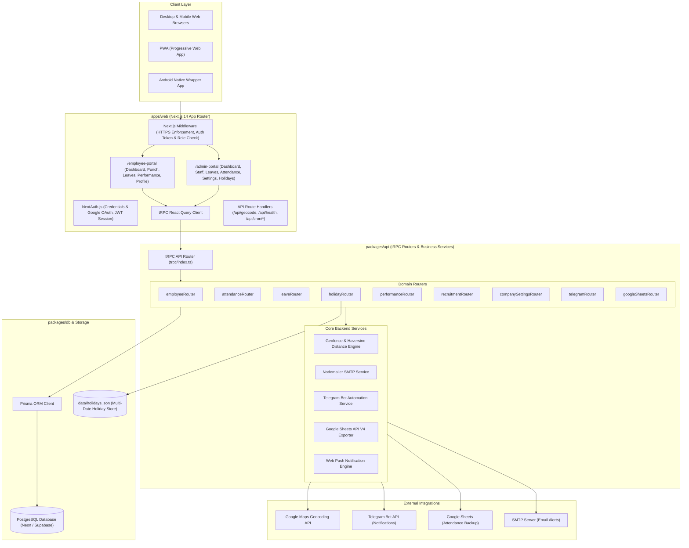
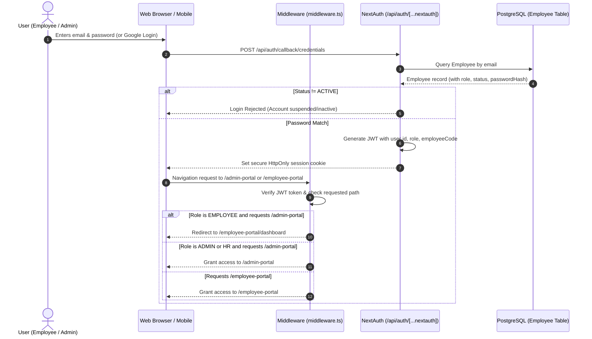
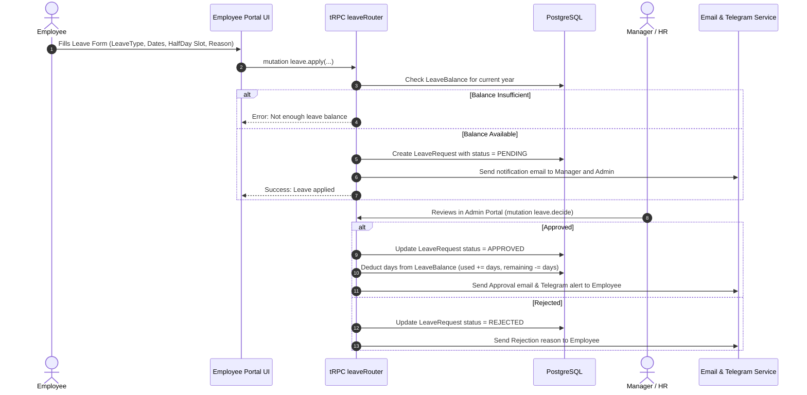
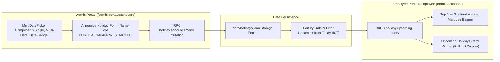
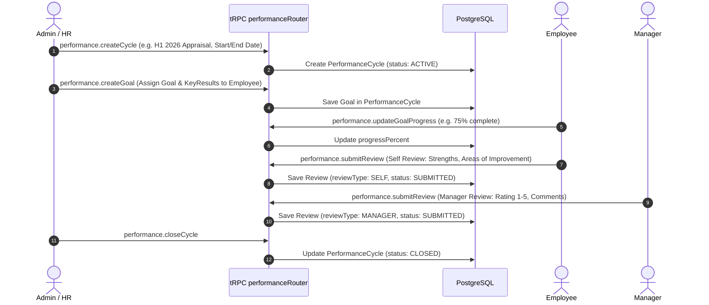
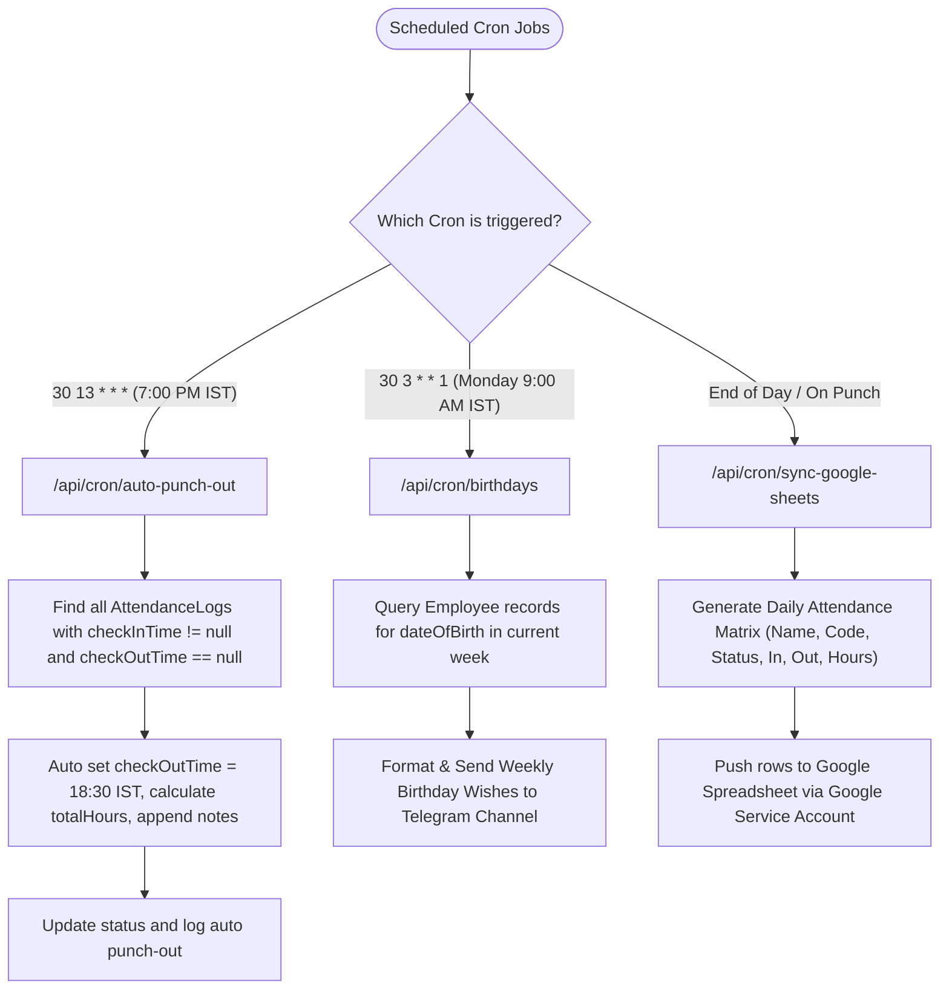

# Realty Smartz HRMS Portal - Complete Architecture & Flow Graph

Yeh document Realty Smartz HRMS Portal ka complete technical aur functional workflow explain karta hai. Isme frontend, backend APIs, database models, background crons aur external integrations ke sare flows step-by-step Mermaid diagrams aur tables ke sath diye gaye hain.

---

## 1. System High-Level Architecture Flow



---

## 2. Authentication & Role-Based Routing Flow

System me 4 user roles hain: `ADMIN`, `HR`, `MANAGER`, aur `EMPLOYEE`.



---

## 3. Attendance Punch Flow (GPS & Geofencing)

Har punch par browser ya mobile device se GPS coordinates capture kiye jate hain. Server in coordinates ko office HQ aur employee ke assigned sites se match karta hai.

```mermaid
flowchart TD
    StartPunch([Employee Clicks Punch In / Out]) --> GetGPS[Browser asks for navigator.geolocation]
    GetGPS --> GotCoords{GPS Available & Allowed?}
    
    GotCoords -- No --> ErrorGPS[Show Error: GPS Permission Required]
    GotCoords -- Yes --> SendPayload[Submit lat, lng, accuracy, photo to attendance.punch]

    SendPayload --> ServerContext[tRPC attendanceRouter: punch mutation]
    ServerContext --> FetchSettings[Fetch CompanySettings: officeLat, officeLng, geofenceRadiusM]
    FetchSettings --> FetchSites[Fetch Employee: assignedLocations up to 3 sites]
    
    FetchSites --> CalcDistance[Calculate Haversine Distance to HQ and all assigned sites]
    CalcDistance --> CheckRadius{Distance <= geofenceRadiusM (e.g. 200m)?}

    CheckRadius -- Yes --> WithinFence[Set withinGeofence = true]
    CheckRadius -- No --> OutsideFence[Set withinGeofence = false & Flag Alert]

    WithinFence --> GeocodeAddress[Call Reverse Geocoding to get human-readable street address]
    OutsideFence --> GeocodeAddress

    GeocodeAddress --> SavePunch[Create AttendancePunch & Update AttendanceLog for today]
    
    SavePunch --> TriggerAlerts[Async Notifications]
    
    subgraph Alerts["Notification Dispatch"]
        TriggerAlerts --> TG[Telegram Bot: Send Punch Summary to Group]
        TriggerAlerts --> Mail[SMTP Mail: Send notification if late or outside geofence]
        TriggerAlerts --> Sheets[Queue Google Sheets daily attendance sync]
    end

    SavePunch --> ResponseClient([Return Success & Update UI Card to Active Punch State])
```

---

## 4. Leave Management Workflow

Employee leave apply karta hai, manager ya HR review karte hain, aur decision email/telegram par notify hota hai.



---

## 5. Upcoming Holidays Management Workflow

Holidays ka system multi-date selection allow karta hai. Admin calendar se multiple dates select karke announce karta hai, jo dashboard aur marquee banner par dynamically appear hoti hain.



---

## 6. Performance & Appraisal Management Workflow

Performance cycle HR create karta hai. Goals assign hote hain, employees self-review karte hain, aur managers rating dete hain.



---

## 7. Background Cron Jobs & Automated Automations

Vercel Cron ya Server Daemon se scheduled tasks execute hote hain:



---

## 8. Monorepo Package Responsibility Summary

| Package / Folder | Purpose | Key Files / Responsibilities |
| :--- | :--- | :--- |
| **`apps/web`** | Next.js 14 Frontend & API Bridge | Pages, Components, NextAuth, Geocoding route, Cron endpoints, Service Worker |
| **`packages/api`** | Business Logic & Routers | 12 domain routers, Geofence calculations, Nodemailer SMTP, Telegram Bot, Google Sheets V4 |
| **`packages/db`** | Database Schema & Client | Prisma ORM, PostgreSQL connection pooling, schema.prisma, Seed scripts |
| **`packages/shared`** | Shared Contracts & Utilities | Zod validation schemas, Role permissions, Date/IST formatters, Constants |
| **`android-app`** | Native Android Packaging | Gradle project, WebView bridge for geolocation permissions, Release keystore |
| **`scripts`** | Tooling & Build Guards | `fix-turbo-permissions.js` (ensures 0755 execute bits on Turbo platform binaries) |
